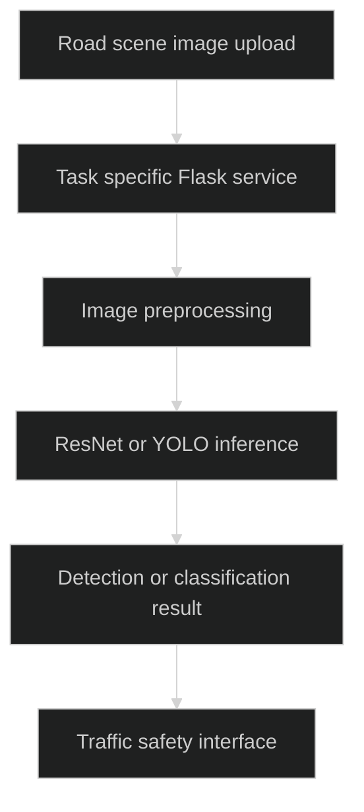

# UrbanFlow

> `Traffic-safety computer-vision experiments exposed through focused Flask services.`

### 🏗️ System Architecture



### 🛠️ Production Stack

Python · Flask · PyTorch · torchvision · YOLO · OpenCV · Firebase · browser JavaScript

### ⚡ Key Engineering Capabilities

- Separate services cover accident, helmet, number-plate and mobile-phone tasks.
- Training notebooks and inference handlers expose the model development path.
- Traffic simulation scripts provide a separate experimentation surface.

### 🚀 Deployment and Local Setup

Run from the repository root after cloning:

```bash
git clone https://github.com/ryash14/UrbanFlow.git
cd UrbanFlow
python3 -m venv .venv
source .venv/bin/activate
python -m pip install flask torch torchvision pillow
cd AccidentDetection
python app.py
```

The example starts only the accident classifier and requires its compatible `accident_detection.pth` weights. Other services have distinct models and dependencies; inspect each entrypoint before running them. This is a collection of experiments, not a unified deployment. No measured accuracy or validated safety decision capability is claimed.

### Source Map

- [AccidentDetection/app.py](AccidentDetection/app.py)
- [HelmetDetection/app.py](HelmetDetection/app.py)
- [ML_Models/acc_det.ipynb](ML_Models/acc_det.ipynb)
- [pygameSimulation/README.md](pygameSimulation/README.md)
