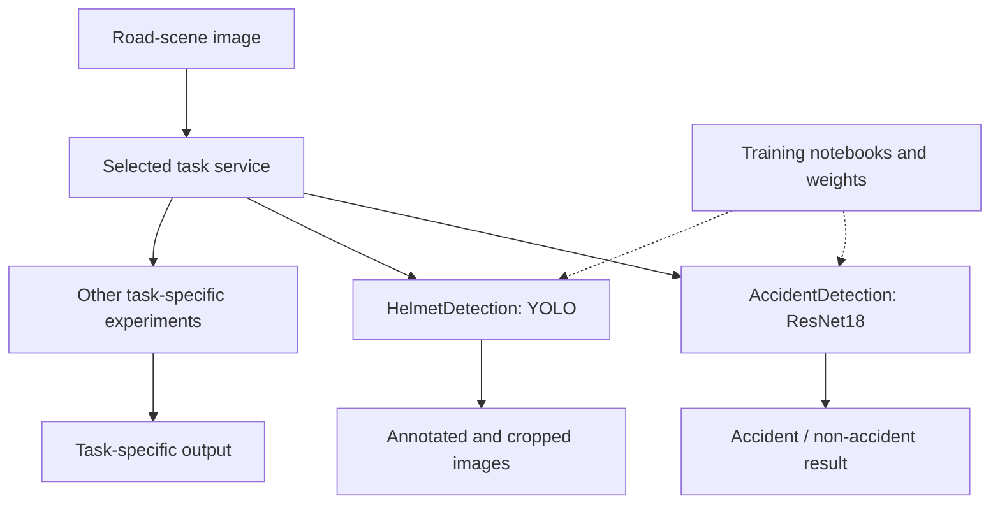

# UrbanFlow

UrbanFlow collects traffic-safety vision experiments, model notebooks and task-specific Flask interfaces.

Different traffic tasks need different models and input assumptions. UrbanFlow keeps accident classification, helmet detection, number-plate work and other experiments in separate services, making the training-to-inference path visible without pretending they form one finished platform.

[Quick start](#quick-start) · [How it works](#how-it-works) · [Development](#development) · [Contributing](CONTRIBUTING.md)

## Quick start

The quick start below runs only accident classification. Its `accident_detection.pth` file must match the architecture. Helmet detection separately requires OpenCV, cvzone, Ultralytics and the model expected at `Weights/best.pt`.

From a fresh checkout:

```bash
git clone https://github.com/ryash14/UrbanFlow.git
cd UrbanFlow
python3 -m venv .venv
source .venv/bin/activate
python -m pip install flask torch torchvision pillow
cd AccidentDetection
python app.py
```

The example starts only the accident classifier and requires its compatible `accident_detection.pth` weights. Other services have distinct models and dependencies; inspect each entrypoint before running them. This is a collection of experiments, not a unified deployment. No measured accuracy or validated safety decision capability is claimed.

## Choosing a component

| Directory | Role |
|---|---|
| `AccidentDetection/` | ResNet18 accident/non-accident image classification |
| `HelmetDetection/` | YOLO helmet detection and annotated/cropped output |
| `NumberPlateDetection/` | Number-plate experiment and web entrypoint |
| `MobilephoneViolation/` | Mobile-phone violation experiment |
| `ML_Models/` | Training and exploration notebooks |
| `pygameSimulation/` | Independent traffic simulation scripts |

Run one component at a time until its model files, dependencies and output contract are verified. The services may use different ports and working-directory assumptions.

## How it works

1. Choose a task directory and obtain its compatible model weights.
2. Start that task’s Flask service with its dependencies.
3. Upload a test image through the associated page or endpoint.
4. Inspect the classification, detection boxes or generated image artifacts. Traffic simulations are separate scripts.

### Component boundaries



### Design decisions

The accident service reconstructs a ResNet18 classifier and loads a PyTorch state dictionary. Helmet detection uses an Ultralytics YOLO model and writes annotated/cropped images. Other task directories have their own entrypoints and assets.

There is no central service orchestrator, shared deployment manifest or unified evaluation report. Model confidence thresholds and example images do not establish real-world safety performance.

## Implementation

**Stack:** Python · Flask · PyTorch · torchvision · YOLO · OpenCV · Firebase · browser JavaScript.

- [AccidentDetection/app.py](AccidentDetection/app.py)
- [HelmetDetection/app.py](HelmetDetection/app.py)
- [ML_Models/acc_det.ipynb](ML_Models/acc_det.ipynb)
- [pygameSimulation/README.md](pygameSimulation/README.md)

## Development

There is no complete automated verification command documented for this application. Start the affected component, use a small synthetic input and inspect its output before changing integrations. The contribution guide describes the evidence expected in a pull request.

## Contributing and support

Report reproducible bugs or propose changes through [GitHub Issues](https://github.com/ryash14/UrbanFlow/issues). Include the relevant environment and a small example rather than private datasets or credentials. See [contributing](CONTRIBUTING.md), [security reporting](SECURITY.md) and the [code of conduct](CODE_OF_CONDUCT.md).

## License

No repository-wide license is currently provided. Third-party components, models and datasets retain their own terms.
